# 📘 Manual de Usuario y Guía de Configuración Operativa
## Sistema de Gestión de Reclamos Web — Don Yeyo S.A.
**Versión:** 1.0.0 | **Área:** Sistemas & Operaciones | **Última Actualización:** Noviembre 2026

---

## 📑 Tabla de Contenidos
1. [Introducción y Arquitectura del Sistema](#1-introducción-y-arquitectura-del-sistema)
2. [Acceso, Autenticación y Perfiles de Usuario](#2-acceso-autenticación-y-perfiles-de-usuario)
3. [Navegación General y Entorno Visual](#3-navegación-general-y-entorno-visual)
4. [Módulo 1: Dashboard Ejecutivo y Analítica en Tiempo Real](#4-módulo-1-dashboard-ejecutivo-y-analítica-en-tiempo-real)
5. [Módulo 2: Bandeja General y Filtros Avanzados de Reclamos](#5-módulo-2-bandeja-general-y-filtros-avanzados-de-reclamos)
6. [Módulo 3: Gestión de Expedientes y Modal de Detalle (4 Vistas Operativas)](#6-módulo-3-gestión-de-expedientes-y-modal-de-detalle-4-vistas-operativas)
7. [Módulo 4: Catálogo de Productos y Categorías de Inocuidad](#7-módulo-4-catálogo-de-productos-y-categorías-de-inocuidad)
8. [Módulo 5: Configuración Global de Parámetros del Sistema](#8-módulo-5-configuración-global-de-parámetros-del-sistema)
9. [Módulo 6: Catálogo de Estados y Descripciones de Flujo](#9-módulo-6-catálogo-de-estados-y-descripciones-de-flujo)
10. [Módulo 7: Matriz de Seguimientos, Recordatorios y Escalamiento](#10-módulo-7-matriz-de-seguimientos-recordatorios-y-escalamiento)
11. [Módulo 8: Auditoría y Centro de Logs](#11-módulo-8-auditoría-y-centro-de-logs)
12. [Módulo 9: Herramientas Operativas Especiales (Simulador, Geometría y Cortesía)](#12-módulo-9-herramientas-operativas-especiales-simulador-geometría-y-cortesía)
13. [Módulo 10: Integración Externa y Consumo API](#13-módulo-10-integración-externa-y-consumo-api)

---

## 1. Introducción y Arquitectura del Sistema

El **Sistema de Gestión de Reclamos Web** de **Don Yeyo S.A.** es una plataforma integral diseñada para orquestar de manera automatizada, transparente y trazable todo el ciclo de vida de los reclamos ingresados por consumidores de la marca.

### Principios del Circuito Operativo:
El flujo de trabajo se divide en **4 ramas de responsabilidad sincronizadas**:
1. **Administración Comercial:** Recibe el reclamo, valida los datos, asigna el supervisor responsable según la zona geográfica, determina el nivel de **Urgencia** (Alta, Media, Baja) y la compensación de cortesía correspondiente, y autoriza el curso del expediente.
2. **Calidad & Inocuidad:** Examina el defecto del producto reclamado, analiza el lote y emite su dictamen técnico formal (**Resuelto**, **Imposibilidad Técnica** o solicitud de reapertura), despachándose el expediente a casillas de correo especializadas según la categoría de producto (`PANES`, `PASTAS`, `TAPAS`, `PIZZAS`).
3. **Supervisores Comerciales:** Reciben la notificación automática geolocalizada con la reposición requerida, coordinan la visita al consumidor, entregan los productos de resarcimiento e informan el resultado mediante enlaces interactivos de confirmación.
4. **Consumidores:** Son informados en tiempo real por correo electrónico institucional, reciben recordatorios automáticos de conservación de muestra y completan una encuesta de conformidad tras la resolución del caso. Si no responden dentro del período límite configurado, el sistema aplica automáticamente la regla **Finalizado Sin Respuesta (FSR)**.

---

## 2. Acceso, Autenticación y Perfiles de Usuario

### 2.1 Acceso al Sistema
Para ingresar al gestor corporativo, abra su navegador web en la dirección institucional provista:
```
http://localhost:5173/   (Entorno Local de Pruebas)
https://gestionreclamos.donyeyo.com.ar/   (Entorno de Producción)
```

### 2.2 Autenticación con Microsoft Entra ID (Office 365)
El acceso se encuentra integrado con las cuentas corporativas de Microsoft de Don Yeyo S.A.:
1. Presione el botón **"Iniciar Sesión con Microsoft"**.
2. Ingrese su correo `@donyeyo.com.ar` y contraseña corporativa.
3. El sistema verificará criptográficamente su identidad y resolverá su rol en el servidor.

### 2.3 Roles de Usuario
- **Administrador (`admin`):** Acceso total a todas las funciones: aprobación/desaprobación de reclamos, configuración global, gestión de supervisores, catálogo de productos, reglas de seguimiento y auditoría.
- **Calidad & Inocuidad (`inocuidad`):** Acceso al Dashboard, bandeja de reclamos y facultad de emitir dictámenes técnicos en la tarjeta de Calidad e Inocuidad de cada expediente.

---

## 3. Navegación General y Entorno Visual

El sistema cuenta con un encabezado superior fijo (*Header*) y un menú lateral desplegable (*Drawer*):

- **Logotipo Institucional Don Yeyo:** Ubicado en el extremo superior izquierdo, actúa como acceso directo al Dashboard principal.
- **Menú Lateral (Hamburguesa ☰):** Despliega el panel de navegación rápida con accesos a la Bandeja de Reclamos, Configuración de Productos, Categorías, Parámetros, Supervisores, Reglas de Cortesía y Logs.
- **Selector de Modo Claro / Oscuro (☀️ / 🌙):** Permite alternar la interfaz entre un tema claro de alto contraste y un tema oscuro optimizado para ambientes de baja luminosidad.
- **Insignia de Usuario:** Muestra las iniciales del usuario autenticado, su correo y el botón para cerrar sesión de manera segura.

---

## 4. Módulo 1: Dashboard Ejecutivo y Analítica en Tiempo Real

El Dashboard proporciona una visión analítica consolidada y en tiempo real de la gestión operativa:

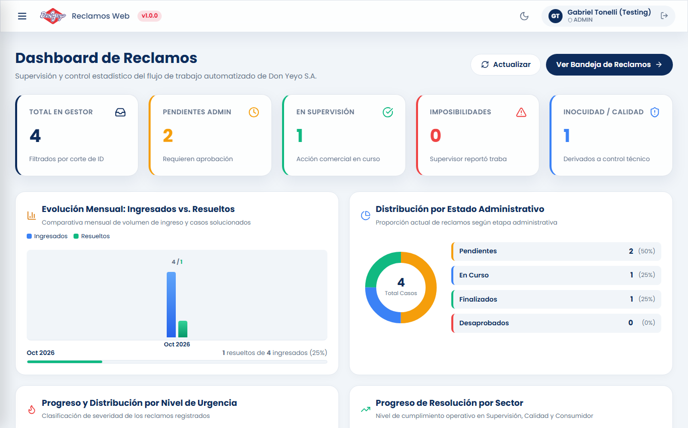

### Componentes del Dashboard:
1. **Tarjetas de KPIs Superiores:**
   - **Total en Gestor:** Volumen histórico consolidado de reclamos registrados.
   - **Pendientes Admin:** Reclamos nuevos que aguardan validación y aprobación por parte de Administración.
   - **En Curso:** Casos activos en proceso de análisis por Inocuidad o visita del supervisor comercial.
   - **Resueltos:** Casos donde la reposición al consumidor ha sido completada exitosamente.
2. **Gráfico de Evolución Mensual (Barras):** Compara mes a mes los reclamos ingresados versus los resueltos, permitiendo evaluar la tasa de resolución de reclamos.
3. **Distribución por Estado Administrativo (Gráfico de Torta):** Muestra el porcentaje de reclamos en estado *Pendiente*, *En curso*, *Aprobado* y *Finalizado*.
4. **Distribución por Nivel de Urgencia:** Desglosa la cantidad de reclamos clasificados como **Alta**, **Media**, **Baja** o *Sin asignar*.
5. **Progreso y Eficiencia por Sector:** Barras porcentuales de rendimiento operativo para Administración, Calidad e Inocuidad, Supervisores Comerciales y Consumidores.

---

## 5. Módulo 2: Bandeja General y Filtros Avanzados de Reclamos

La Bandeja de Reclamos (`/reclamos`) presenta la tabla de alta densidad con todos los expedientes del sistema:

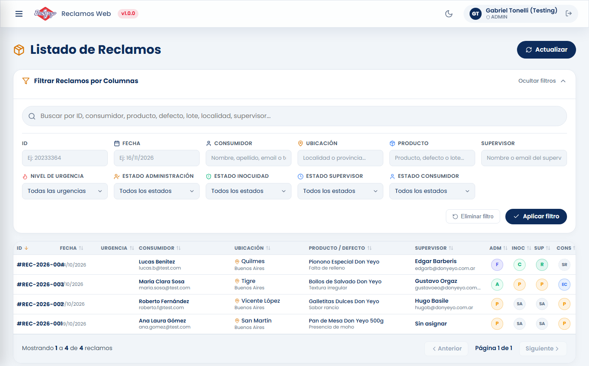

### Funcionalidades de la Grilla:
- **Ordenamiento Multicolumna:** Haga clic sobre el encabezado de cualquier columna (ej. *ID*, *Fecha*, *Urgencia*, *Consumidor*, *Localidad*, *Supervisor*) para ordenar ascendente o descendentemente.
- **Columnas Urgencia y Fecha de Ingreso:** Identifican visualmente la criticidad de cada caso y la fecha exacta de ingreso.
- **Insignias de Estado Compactas y Circulares:** Cada sector cuenta con su propio círculo de color con abreviatura identificatoria:
  - `P` (Pendiente - Ámbar)
  - `EC` (En curso - Azul)
  - `R` (Resuelto - Verde)
  - `A` (Aprobado - Verde esmeralda)
  - `D` (Desaprobado - Rojo)
  - `I` (Imposibilidad - Púrpura)
  - `F` / `SR` (Finalizado / Sin Respuesta - Gris)
  *Al posar el cursor sobre cualquier círculo, un tooltip desplegará la descripción explicativa completa.*

### Panel Desplegable de Filtros Combinables:
Presione el botón **"Desplegar filtros"** para abrir el acordeón de búsqueda avanzada:
- **Buscador General:** Busca texto libre por ID, nombre del consumidor, producto reclamado, defecto, lote, localidad o supervisor.
- **Filtros Específicos por Columna:**
  - *ID Reclamo*
  - *Fecha de Ingreso*
  - *Consumidor*
  - *Ubicación (Localidad / Provincia)*
  - *Producto / Defecto*
  - *Supervisor Asignado*
  - *Nivel de Urgencia (Alta, Media, Baja)*
  - *Estado Administración, Inocuidad, Supervisor y Consumidor*
- **Botón "Aplicar filtro":** Ejecuta la combinación de todos los criterios ingresados sin recargar la página.
- **Botón "Eliminar filtro":** Limpia de inmediato todos los selectores y restablece la grilla completa.

---

## 6. Módulo 3: Gestión de Expedientes y Modal de Detalle (4 Vistas Operativas)

Al hacer clic sobre cualquier fila de la grilla de reclamos, se abre el modal interactivo de gestión del expediente:

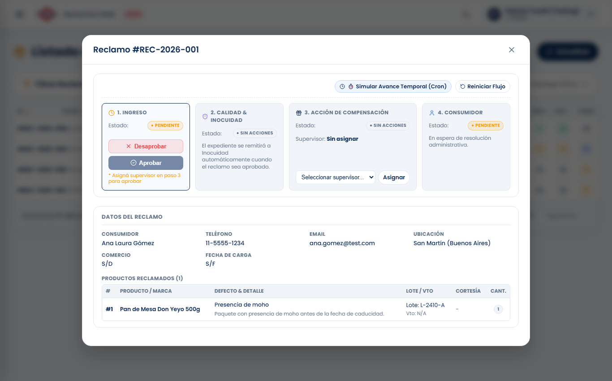

El modal organiza el expediente en **4 tarjetas sincronizadas**:

### Tarjeta 1: Aprobación Administrativa
- **Nivel de Urgencia:** Desplegable para seleccionar **Alta**, **Media** o **Baja**. Al modificarlo, se actualiza en tiempo real la cantidad de días del SLA y el desglose de los ítems de cortesía correspondientes.
- **Supervisor Comercial:** Es requisito indispensable que el reclamo posea un supervisor asignado antes de poder ser aprobado.
- **Botón Aprobar:** Notifica automáticamente por correo al supervisor comercial y al equipo de Calidad e Inocuidad, actualiza el estado a `En curso` y registra el evento en auditoría.
- **Botón Desaprobar / Rechazar:** Permite ingresar un motivo formal de rechazo, actualiza el estado a `Desaprobado` y notifica al consumidor con el argumento formal.

### Tarjeta 2: Calidad & Inocuidad
- Permite al equipo técnico registrar su dictamen sobre el defecto reportado.
- Dispone de botones directos para declarar **Dictamen Resuelto**, **Imposibilidad Técnica** (justificando motivos) o **Reabrir Análisis**.
- Las notificaciones se despachan a las casillas de laboratorio correspondientes según la categoría del producto.

### Tarjeta 3: Supervisores Comerciales
- Muestra el supervisor responsable de la zona y su correo electrónico.
- Permite reasignar el supervisor manualmente si fuera necesario.
- Registra si el supervisor ha entregado la reposición o si ha reportado imposibilidad de contacto.

### Tarjeta 4: Consumidor y Regla FSR
- Exhibe el estado de respuesta del consumidor a la encuesta de satisfacción.
- Si el consumidor no responde tras cumplirse el plazo máximo configurado en la matriz de seguimiento, el sistema pasa el estado a **Finalizado Sin Respuesta (FSR)**.

### Tabla de Productos Reclamados:
En la sección inferior del modal se listan todos los productos reclamados con su código, lote, fecha de vencimiento, defecto declarado y los ítems de cortesía asignados, con soporte de desplazamiento táctil horizontal para pantallas compactas.

---

## 7. Módulo 4: Catálogo de Productos y Categorías de Inocuidad

### 7.1 Catálogo de Productos (`/configuracion/productos`)
Permite gestionar la lista de productos de la empresa:

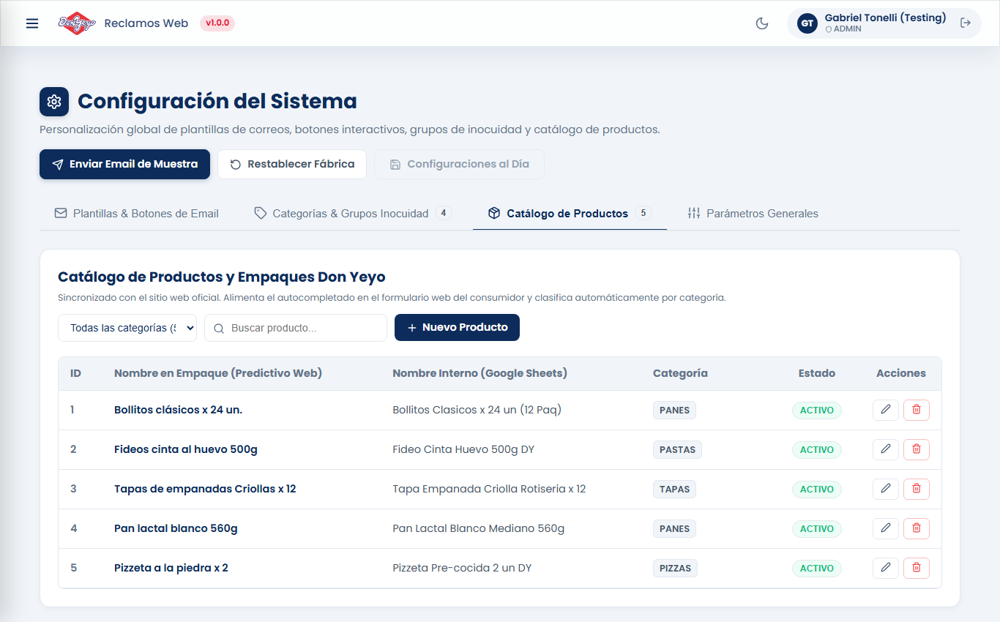

- **Nombre Comercial de Empaque:** Nombre legible y amigable que visualiza el consumidor en el formulario web (ej: *"Bollitos clásicos x 24 un."*).
- **Nombre Técnico Interno:** Denominación técnica utilizada en los sistemas internos de planta y planillas (ej: *"Bollitos Clasicos x 24 un (12 Paq)"*).
- **Categoría:** Vincula el producto a su familia (`PANES`, `PASTAS`, `TAPAS`, `PIZZAS`).
- **Estado Activo / Inactivo:** Permite deshabilitar temporalmente productos sin eliminarlos de la base de datos.
- **Botón "Nuevo Producto":** Abre el formulario modal para dar de alta un nuevo producto.

### 7.2 Categorías & Grupos de Inocuidad (`/configuracion/categorias`)
Permite definir las casillas de correo que investigarán los reclamos según el tipo de producto:

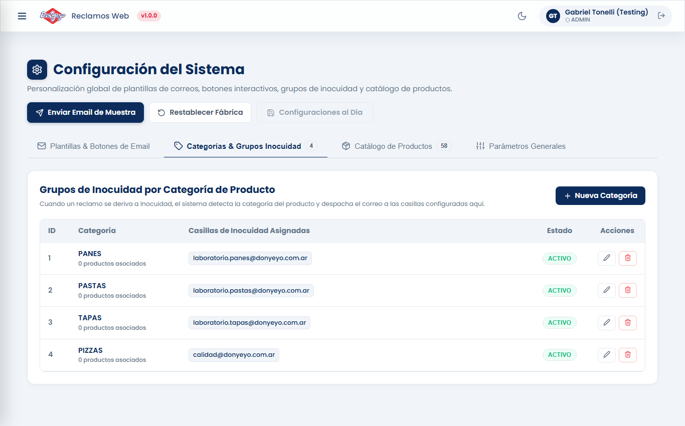

- Cada categoría (`PANES`, `PASTAS`, `TAPAS`, `PIZZAS`) cuenta con uno o varios correos electrónicos asociados (separados por coma).
- Si un reclamo incluye productos de distintas categorías, el sistema unifica automáticamente los destinatarios evitando envíos duplicados.

---

## 8. Módulo 5: Configuración Global de Parámetros del Sistema

La pestaña de **Parámetros** (`/configuracion/parametros`) centraliza las directivas operativas de Don Yeyo S.A.:

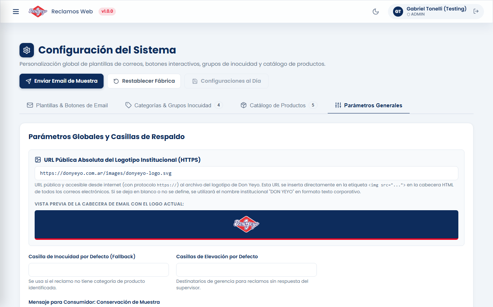

- **SLA Límite de Resolución (`SLA_DIAS_CORTE`):** Días hábiles máximos para resolver un expediente antes de que el sistema emita alertas de mora.
- **Alerta de Seguimiento al Supervisor (`CORTE_SLA_SEGUIMIENTO_SUPERVISOR`):** Días para enviar el primer recordatorio por correo al supervisor comercial.
- **Logotipo Institucional en Correos (`EMAIL_LOGO_URL`):** URL HTTPS pública de la imagen de cabecera que se incrusta en los emails salientes.
- **Aviso de Conservación de Muestra (`MENSAJE_CONSERVAR_MUESTRA`):** Texto sugerido al consumidor al cargar el reclamo para conservar el producto dañado.
- **Firma Legal al Pie (`EMAIL_FOOTER_TEXT`):** Texto de pie de página para todos los correos institucionales.

---

## 9. Módulo 6: Catálogo de Estados y Descripciones de Flujo

En `/estados`, los administradores pueden personalizar la semántica visual del flujo:

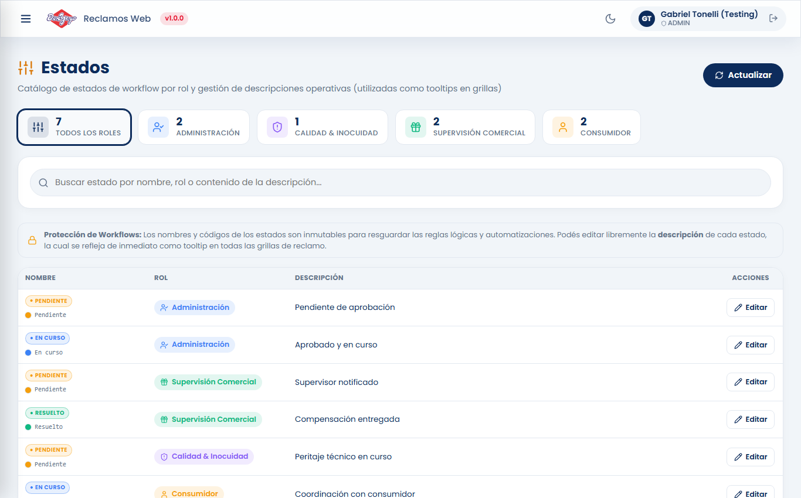

- **4 Actores:** Administración, Inocuidad, Supervisor y Consumidor.
- **Descripción Explicativa:** Texto pedagógico que describe con precisión qué significa cada estado operativo.
- **Color Institucional:** Selector de color hexadecimal asociado a cada estado para asegurar consistencia visual en todas las pantallas.

---

## 10. Módulo 7: Matriz de Seguimientos, Recordatorios y Escalamiento

En `/seguimientos`, se configura el motor de alertas automáticas:

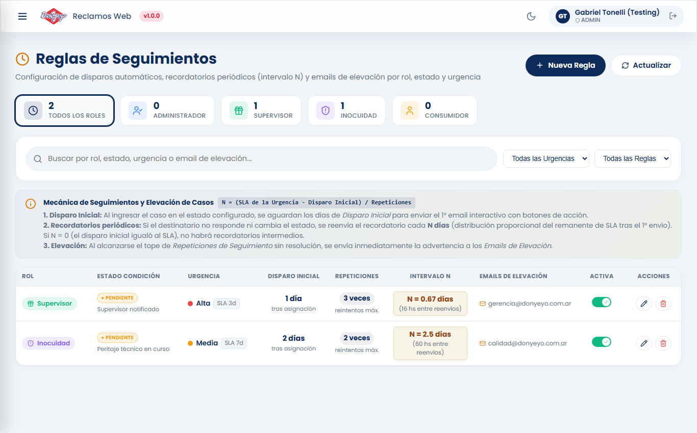

- **Reglas por Rol y Urgencia:** Define cuántos días deben transcurrir para enviar el 1°, 2° y 3° correo de seguimiento.
- **Escalamiento a Gerencia:** Superado el plazo límite del supervisor, el sistema envía una alerta de escalamiento a la casilla configurada (`EMAILS_ELEVACION`).
- **Encuesta de Satisfacción:** Dispara automáticamente la consulta al consumidor tras la entrega informada por el supervisor.

---

## 11. Módulo 8: Auditoría y Centro de Logs

En `/logs`, el sistema provee trazabilidad integral:

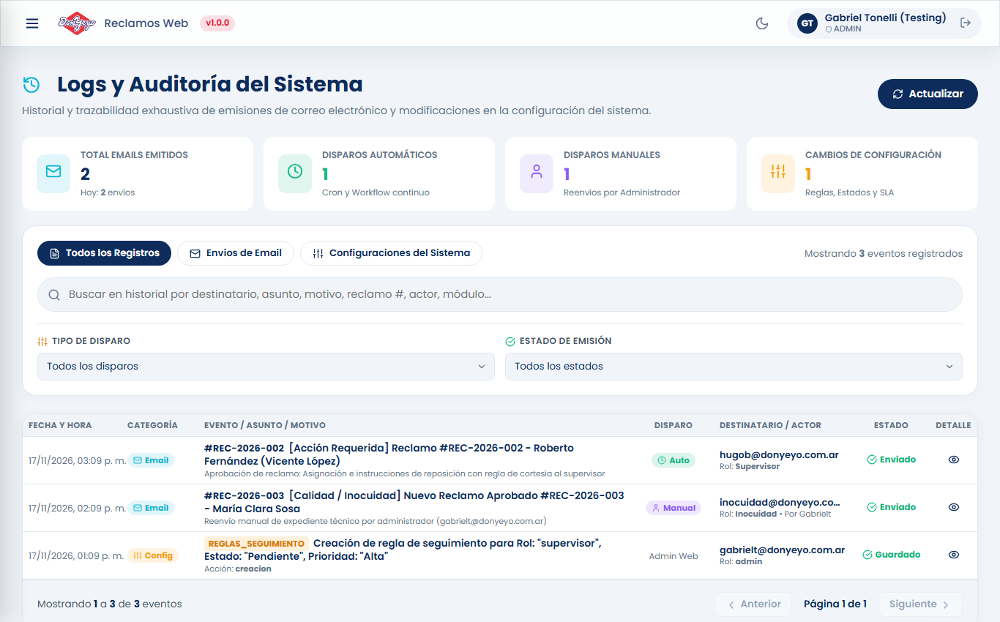

- **Filtros por Categoría:** *Todos los Logs*, *Emails Salientes* y *Auditoría de Configuración*.
- **Trazabilidad de Emails:** Detalla fecha y hora exacta, destinatario, asunto, estado de entrega SMTP y cuerpo del mensaje.
- **Auditoría de Reclamos:** Registra cada cambio de estado, actor interviniente y motivo de modificación.

---

## 12. Módulo 9: Herramientas Operativas Especiales (Simulador, Geometría y Cortesía)

### 12.1 Simulador Temporal para Pruebas Operativas
Accesible desde el modal de detalle del reclamo mediante el botón **"Simulador Temporal"**:

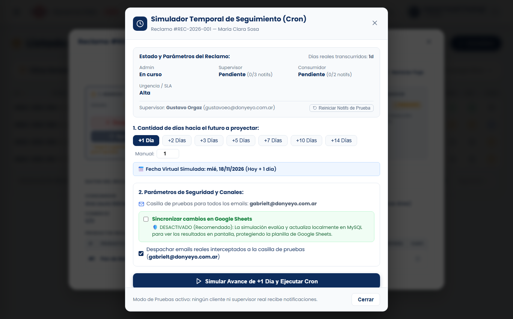

- **Avance Controlado de Días:** Permite adelantar artificialmente 1, 3, 5 o más días la antigüedad de un reclamo para evaluar cómo reacciona el motor de seguimientos.
- **Disparo Manual del Cron:** Ejecuta la rutina periódica de evaluación sin aguardar el horario programado.
- **Protección de Google Sheets:** Casilla de verificación para evitar sobreescribir planillas reales durante ensayos.

### 12.2 Cobertura Geográfica de Supervisores
Permite visualizar sobre mapa interactivo los polígonos GeoJSON correspondientes a cada zona comercial (*Zona Norte*, *Zona Oeste*, *Zona Sur*) y cuenta con un probador de coordenadas latitud/longitud para validar a qué supervisor se asignará un reclamo de forma automática.

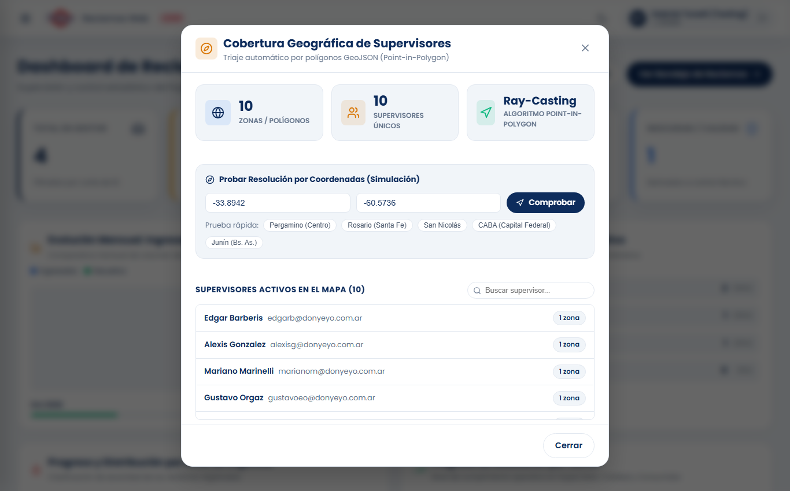

### 12.3 Reglas de Cortesía y Niveles de Urgencia
Permite gestionar la matriz de compensaciones según el nivel de urgencia asignado:
- **Alta (Código 10):** SLA de 3 días corridos. Ítems: *1 reemplazo + 2 productos a elección + 2 de kg*.
- **Media (Código 20):** SLA de 7 días corridos. Ítems: *1 reemplazo*.
- **Baja (Código 30):** SLA de 14 días corridos. Ítems: *1 reemplazo + 1 de kg*.

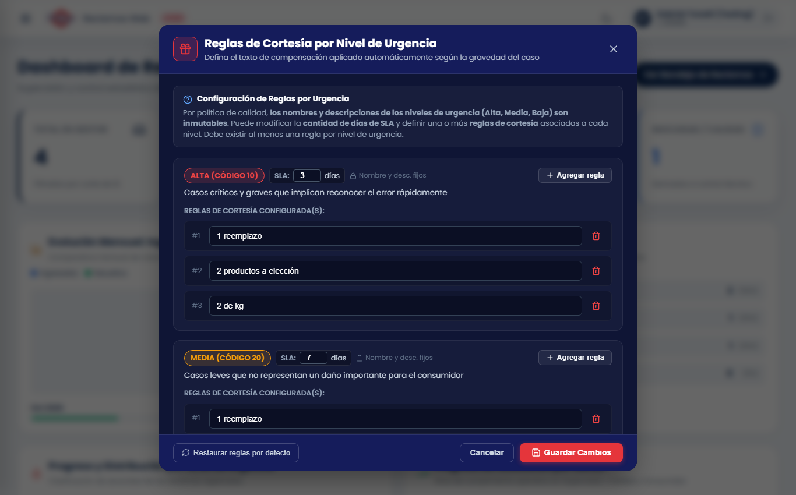

---

## 13. Módulo 10: Integración Externa y Consumo API

### 13.1 Consulta Externa del Catálogo de Productos
Para aplicaciones externas o el portal web principal de Don Yeyo, se dispone de un endpoint `GET` protegido con **Autenticación HTTP Basic**:

```bash
curl -X GET "http://localhost:3001/api/public/productos?q=pan" \
     -u donyeyo_api:dy_prod_2026_secure \
     -H "Accept: application/json"
```

### 13.2 Portales Públicos para Usuarios Externos
- **Portal de Imposibilidad Técnica del Supervisor:** Enlace firmado por token que permite al supervisor declarar imposibilidad de contacto o reposición con motivo formal.
- **Portal de Encuesta de Satisfacción del Consumidor:** Enlace seguro que permite al cliente calificar el servicio recibido con una escala de satisfacción o reportar inconvenientes.

---

> **Propiedad Intelectual:** Sistema de Gestión de Reclamos Web © 2026 **Don Yeyo S.A.** Todos los derechos reservados.
